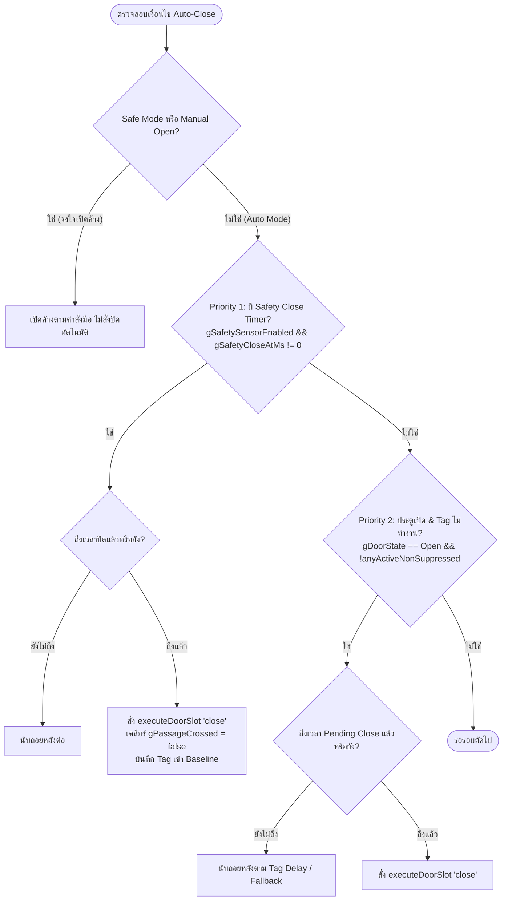
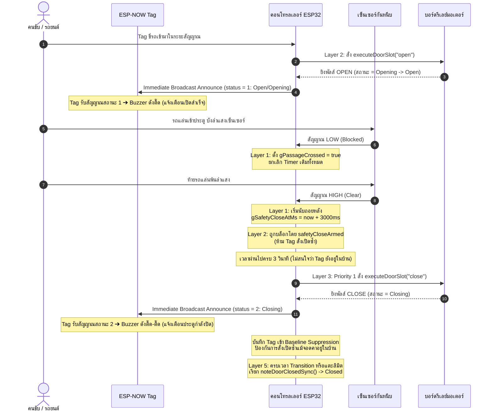
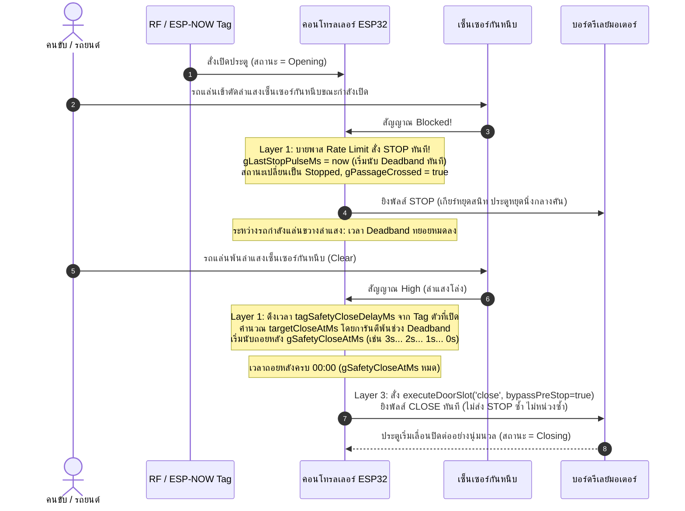
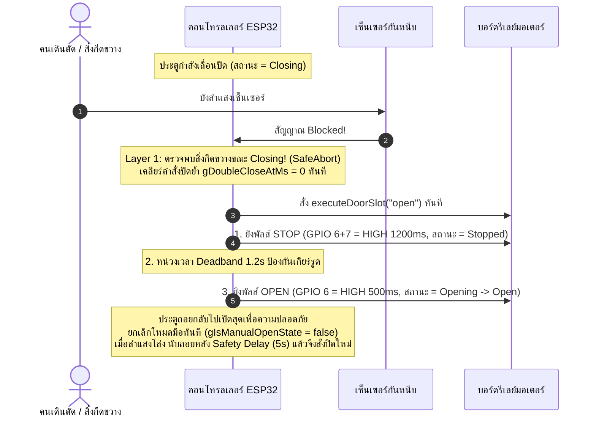

# 🚪 สถาปัตยกรรมและกระบวนการทำงานของระบบประตูอัตโนมัติ (Door Automation Workflow Specification)

> **เอกสารอ้างอิงหลัก (Single Source of Truth)** สำหรับ AI และนักพัฒนาในการออกแบบ แก้ไข และทดสอบโค้ดระบบประตูอัตโนมัติ `AutoDoor-RF2 (ESP-NOW / RF433)`
> 
> *เป้าหมาย: ประตูต้องเปิด-ปิด แม่นยำ ไม่ค้าง ไม่กระตุก ไม่ส่งสัญญาณซ้ำซ้อน และปลอดภัย 100%*

---

## 📑 สารบัญ (Table of Contents)
1. [กฎเหล็กที่ไม่สามารถละเมิดได้ (Core Invariants)](#1-กฎเหล็กที่ไม่สามารถละเมิดได้-core-invariants)
2. [สถาปัตยกรรม 5 เลเยอร์ (5-Layer Architecture)](#2-สถาปัตยกรรม-5-เลเยอร์-5-layer-architecture)
3. [ลำดับความสำคัญในการสั่งปิด (Auto-Close Priority Hierarchy)](#3-ลำดับความสำคัญในการสั่งปิด-auto-close-priority-hierarchy)
4. [แผนผังสถานะประตู (State Machine Matrix)](#4-แผนผังสถานะประตู-state-machine-matrix)
5. [ลำดับเหตุการณ์การทำงานจริง (Step-by-Step Sequence Flows)](#5-ลำดับเหตุการณ์การทำงานจริง-step-by-step-sequence-flows)
   - [5.1 กรณีปกติ: Tag สั่งเปิด ➔ รถขับผ่านเซ็นเซอร์ ➔ ปิดอัตโนมัติ](#51-กรณีปกติ-tag-สั่งเปิด--รถขับผ่านเซ็นเซอร์--ปิดอัตโนมัติ)
   - [5.2 กรณีรถขับผ่านเร็ว: ผ่านเซ็นเซอร์ขณะประตูกำลังเปิด (Mid-Stroke Reversal)](#52-กรณีรถขับผ่านเร็ว-ผ่านเซ็นเซอร์ขณะประตูกำลังเปิด-mid-stroke-reversal)
   - [5.3 กรณีพบสิ่งกีดขวางขณะประตูกำลังปิด (Emergency Obstacle Reverse)](#53-กรณีพบสิ่งกีดขวางขณะประตูกำลังปิด-emergency-obstacle-reverse)
   - [5.4 กรณีเปิดค้างด้วยมือ (Manual Hold Mode)](#54-กรณีเปิดค้างด้วยมือ-manual-hold-mode)
6. [ตารางตัวแปรสำคัญและหน้าที่ (Key State Variables)](#6-ตารางตัวแปรสำคัญและหน้าที่-key-state-variables)
7. [ข้อห้ามและข้อผิดพลาดในอดีต (Anti-Patterns & Past Bug Fixes)](#7-ข้อห้ามและข้อผิดพลาดในอดีต-anti-patterns--past-bug-fixes)

---

## 1. กฎเหล็กที่ไม่สามารถละเมิดได้ (Core Invariants)

> [!CAUTION]
> ห้ามเปลี่ยนแปลงโค้ดที่ขัดแย้งกับกฎเหล็กเหล่านี้โดยเด็ดขาด:

1. **Safety Beam คือสิทธิ์ขาดในการสั่งปิด (Primary Authority for ESP-NOW Tag):**
   เมื่อเซ็นเซอร์กันหนีบถูกเปิดใช้งาน (`gSafetySensorEnabled == true`) และมีรถพก ESP-NOW Tag ขับตัดลำแสง (`gPassageCrossed == true`) จังหวะการนับถอยหลังปิดต้องอิงตาม **Safety Sensor และเวลาหน่วงของ Tag (`tagSafetyCloseDelayMs`) เท่านั้น** ต่อให้สัญญาณ ESP-NOW Tag ยังคงส่งสัญญาณหรือจอดคาอยู่ในบ้าน ประตูก็ **ต้องปิดตามเวลาที่กำหนด** สัญญาณ Tag ที่ยังอยู่ในบ้านจะไม่มีสิทธิ์ขยายเวลาปิด (เลื่อนเวลาหนี) อีกต่อไป
2. **ห้ามสั่งปิดขณะมีสิ่งกีดขวางเด็ดขาด:**
   ถ้า `gSafetySensorBlocked == true` คำสั่ง `close` ต้องถูกปฏิเสธทันที และหากประตูกำลังเลื่อนปิดอยู่ ต้อง **STOP และดีดกลับเป็น OPEN ทันที** (โดยระบบจะเคลียร์คิว `gDoubleCloseAtMs = 0` เสมอเพื่อป้องกันพัลส์ปิดย้ำยิงแทรก)
3. **การสั่งปิดประตูผ่าน Pre-Stop และ Deadband 2.4 วินาที (Reversal Deadband):**
   เมื่อมีคำสั่งปิด (`CLOSE`) ขณะที่ประตูกำลังเลื่อนเปิด (`Opening`) กลางคัน ระบบจะส่งพัลส์ `STOP` (GPIO 6+7 = HIGH 1200ms ผ่านฮาร์ดแวร์รีจิสเตอร์พร้อมกัน) ➔ หน่วงเวลา Deadband 1.2 วินาที เพื่อให้เกียร์และมอเตอร์หยุดสนิท ➔ แล้วจึงยิงพัลส์ `CLOSE` แน่นหนา (GPIO 7 = HIGH 800ms, `kReversePulseMs = 800`) รวม 2.4 วินาที
   *ข้อสำคัญ:* หากประตูหยุดนิ่งอยู่แล้ว (`Open` หรือ `Stopped` พ้นช่วง Deadband แล้ว) ให้ยิงพัลส์ `CLOSE` (800ms) ตรงได้เลย **ห้ามส่งพัลส์ STOP ซ้ำ** เพื่อป้องกันเสียง Piezo Buzzer ของบอร์ดมอเตอร์ร้องเตือนกวนใจและป้องกัน MCU บอร์ดมอเตอร์ล็อก
4. **ห้ามส่งสัญญาณ STOP เบิ้ล 2 ครั้ง:**
   รีเลย์ต้องส่งพัลส์เดี่ยวสะอาด (Single STOP Pulse 1200ms) การส่ง STOP ซ้ำซ้อนทำให้บอร์ดคอนโทรลมอเตอร์เข้าสู่ Safe Lock และหยุดค้าง
5. **เสียงเตือน Tag Buzzer สำหรับ ESP-NOW Tag (2-Way Active):**
   - ESP-NOW Tag เป็นอุปกรณ์ 2-Way Active จะมีเสียงเตือน **ทั้งตอนเปิดสำเร็จ (`status = 1`) และตอนประตูกำลังปิด (`status = 2`)**
   - คอนโทรลเลอร์จะ Broadcast สถานะทุก 250ms และส่งทันทีเมื่อรับบีคอนจาก Tag (`triggerImmediateAnnounce()`) เพื่อให้ Tag ที่ตื่นขึ้นมารับเสียงเตือนได้ทันใน RX window
   - ไม่เหมือนกับรีโมท RF 433MHz ซึ่งเป็นแบบ 1-way ทางเดียว (ไม่มีบอร์ดรับเสียงเตือนกลับ)
6. **การป้องกัน Deadlock สถานะ `DoorState::Stopped`:**
   Priority 2 Fallback Auto-Close และ Priority 3 Failsafe ต้องตรวจสอบทั้ง `gDoorState == DoorState::Open` และ `gDoorState == DoorState::Stopped` เสมอ เพื่อไม่ให้ประตูที่หยุดนิ่งกลางคันค้างเปิดตลอดกาล
7. **สวิตช์แม่เหล็ก/ลิมิตสวิตช์มีหน้าที่แค่แสดงผลและรีเซ็ตสถานะ:**
   เซ็นเซอร์ตำแหน่งประตู (Magnetic Sensor / Built-in Limits) มีไว้เพื่อ Sync หน้าจอ UI และรีเซ็ตสถานะเมื่อปิดสนิทเท่านั้น **ห้ามนำมาใช้เป็นตัวตัดสินใจสั่งปิด**
8. **ป้องกันการสั่ง OPEN ซ้ำขณะประตูกำลังเปิด (Duplicate OPEN Rejection):**
   เมื่อประตูมีสถานะเป็น `DoorState::Opening` หรืออยู่ในคิว Reversal Deadband เตรียมเปิด คำสั่ง `open` ซ้ำต้องถูกเพิกเฉยทันที เพื่อป้องกันรีเลย์สับเบิ้ลและป้องกันไม่ให้บอร์ดมอเตอร์หยุดหมุนกะทันหัน
9. **ความแตกต่างระหว่าง ESP-NOW Tag กับ RF Remote (433MHz):**
   - **ESP-NOW Tag**: สื่อสารสองทาง ส่งบีคอนเป็นระยะ มีเสียง Buzzer ตอบรับทั้งตอนเปิด (`status = 1`) และปิด (`status = 2`) เมื่อรถตัดเซ็นเซอร์กันหนีบ ประตูต้องปิดตามเวลาของ Tag เสมอแม้ Tag ยังส่งสัญญาณอยู่ และเมื่อเริ่มปิดระบบจะ Snapshot เข้า Baseline Suppression ทันทีเพื่อไม่ให้เปิดซ้ำ
   - **RF Remote 433MHz**: สื่อสารทางเดียวตามจังหวะการกดปุ่มของผู้ใช้ (ไม่มีเสียงตอบรับที่ตัวรีโมท) กดสั้น = Toggle, กดค้าง 4 วินาที = Manual Hold (ไม่เข้า Baseline Suppression)

---

## 2. สถาปัตยกรรม 5 เลเยอร์ (5-Layer Architecture)

การทำงานใน `stepDoorLogic()` ถูกจัดกลุ่มเป็น 5 เลเยอร์ที่แยกหน้าที่กันอย่างเด็ดขาด ทำงานวนรอบทุก 10-20ms:

```mermaid
graph TD
    L1[Layer 1: Sensors & Input Processing<br>Queue, Magnetic, Safety Beam, Debounce] --> L2
    L2[Layer 2: Tag & Trigger Evaluation<br>ESP-NOW/RF Tag Detection, Baseline Suppression] --> L3
    L3[Layer 3: Auto-Close Decision Engine<br>Priority 1: Safety Close | Priority 2: Tag Fallback | Priority 3: Failsafe] --> L4
    L4[Layer 4: Actuator & Relay Deadband<br>Reversal Handler, Pulse Execution, Rate Limiting] --> L5
    L5[Layer 5: Transition & State Completion<br>EndMs Timer, State Synchronization, Closed Reset]
```

### รายละเอียดแต่ละเลเยอร์:

* **Layer 1: Sensors & Hardware Inputs (ประมวลผลเซ็นเซอร์)**
  * ดึงคำสั่งจาก FreeRTOS Queue (`gDoorCmdQueue`) มาประมวลผลตามลำดับ FIFO
  * กรองสัญญาณรบกวน Safety Sensor ด้วย **Fast Asymmetric Debounce**: ตรวจจับการตัดลำแสงใน **10ms** (ดักจับมอเตอร์ไซค์เร็ว) และตรวจสอบลำแสงโล่งใน **50ms** (เสถียร ไม่กวน)
  * บันทึกการข้ามประตู: เมื่อลำแสงถูกบัง ➔ ตั้ง `gPassageCrossed = true`
  * เมื่อลำแสงโล่งและมีประวัติการข้าม ➔ ตั้งเวลาปิด `gSafetyCloseAtMs = now + delay`
  * หากลำแสงถูกตัดขณะประตูกำลังเลื่อนปิด (`Closing`) ➔ สั่ง Emergency Reverse เป็น `Open` ทันที

* **Layer 2: Tag & Trigger Evaluation (ประเมินสัญญาณ Tag)**
  * ค้นหา Tag ที่กำลังส่งสัญญาณ (Active Tags)
  * จัดการ Baseline Suppression (บันทึก Tag ที่จอดคาอยู่ในบ้านเพื่อไม่ให้เปิดซ้ำ)
  * **Safety Guard:** ตรวจสอบว่า `safetyCloseArmed` หรือไม่ หากมี Safety Close นับถอยหลังอยู่ หรืออยู่ในช่วง Reversal Deadband ปิดประตู ➜ **ห้าม Layer 2 สั่งเปิดเด็ดขาด**

* **Layer 3: Auto-Close Decision Engine (เครื่องยนต์ตัดสินใจสั่งปิด)**
  * เลือกลำดับคำสั่งปิดตาม Priority 1 ➜ 2 ➜ 3 (ดูหัวข้อที่ 3)
  * ไร้ Deadlock: มี Fallback Auto-Close ใน Priority 2 รองรับเสมอหาก Safety Close ถูกยกเลิก

* **Layer 4: Directional Reversal Deadband Actuator (ควบคุมการกลับทิศทาง)**
  * จัดการคิว Reversal Deadband (500ms / 0.5 วินาที) เมื่อมีการกลับทิศทางมอเตอร์กลางคัน เพื่อป้องกันมอเตอร์และเกียร์เสียหาย
  * ควบคุม Rate Limit ป้องกัน Relay ทำงานถี่เกินไป (250ms) แต่ **ยกเว้นให้ Safety Close เสมอ**

* **Layer 5: Transition Timer, State Completion & Auto-Retry Close Engine (จบสถานะและสั่งปิดซ้ำอัตโนมัติ)**
  * นับเวลาการเคลื่อนที่ `gDoorTransitionEndMs`
  * เมื่อหมดเวลาเลื่อนเปิด ➔ เปลี่ยนเป็น `Open`
  * เมื่อหมดเวลาเลื่อนปิด (`Closing`):
    * หากเปิดใช้งานเซ็นเซอร์แม่เหล็ก (`gMagSensorEnabled`) หรือลิมิตสวิตช์ (`gBuiltinSensorsEnabled`): ระบบจะตรวจสอบว่า **แม่เหล็กแตะติดสนิทจริงหรือไม่**
    * หากเวลาหมดแต่แม่เหล็กยังไม่แตะ (แง้มอยู่/สะดุดราง) และเปิดใช้ `gAutoRetryCloseEnabled` ➔ **ระบบสั่งยิงพัลส์ CLOSE ซ้ำอัตโนมัติ (Auto-Retry Close)** 1-5 ครั้ง (ค่าเริ่มต้น 3 ครั้ง หน่วง 3 วินาที)
    * หากแม่เหล็กดูดติดสนิท ➔ เปลี่ยนเป็น `Closed` และเรียก `noteDoorClosedSync()` รีเซ็ตระบบสู่ Auto Mode สะอาด 100%

### 🔄 ฟังก์ชัน State Reset & Idle Sanitizer:
1. `noteDoorClosedSync(now)`: เรียกเมื่อประตูปิดสนิท (ทั้งจากเซ็นเซอร์ตำแหน่งและ Transition Timer) ทำการรีเซ็ตสถานะเป็น `Closed`, เคลียร์ตัวแปร และบันทึก Tag เข้า Baseline (`snapshotBaseline(now)`)
2. `noteClosingStarted(now)`: เรียกเมื่อเริ่มกระบวนการปิดประตู (`executeDoorSlot("close")` หรือ `STOP` ด้วยมือ) เพื่อยกเลิกคิวปิดเดิมและบล็อก Tag ทันที
3. `snapshotBaseline(now)`: ดึงรายชื่อ Tag ที่ Active อยู่ ณ ขณะนั้นเข้า `gTagBaselineActiveIds` และตั้ง `gTagOpenSuppressed = true` ป้องกันการแย่งเปิดซ้ำเมื่อรถจอดในบ้าน
4. `Idle State Sanitizer`: เมื่อประตูปิดสนิทครบ 15 วินาทีและไม่มี Tag ส่งสัญญาณ ระบบจะล้างค่าสถานะคงค้างทั้งหมดใหม่อัตโนมัติ เพื่อให้การเปิดรอบถัดไปทำงานบนสภาพแวดล้อมที่สะอาด 100%

---

## 3. ลำดับความสำคัญในการสั่งปิด (Auto-Close Priority Hierarchy)

เมื่อประตูอยู่ในสถานะเปิด (`Open`), กำลังเปิด (`Opening`), หรือหยุด (`Stopped`) เลเยอร์ 3 จะเลือกใช้เงื่อนไขปิดตามลำดับความสำคัญสูงสุดลงมา:



1. **Priority 1: Safety Sensor Auto-Close (`gSafetyCloseAtMs`) — สิทธิ์สูงสุด**
   * เกิดขึ้นเมื่อ: รถขับตัดลำแสงและพ้นออกไปแล้ว (`gPassageCrossed == true`)
   * เวลาหน่วง: ดึงจาก `tagSafetyCloseDelayMs` ของ Tag ตัวที่สั่งเปิด (หรือค่า Global `gSafetyCloseDelayMs` เริ่มต้น 3 วินาที หรือ 0 วินาที)
   * คุณสมบัติพิเศษ: ทำงานเด็ดขาด ไม่สนใจว่า Tag จะยังอยู่ในบ้านหรือไม่ และข้าม Rate Limit 250ms ทันที

2. **Priority 2: Tag Auto-Close & Fallback (`gPendingCloseAtMs`) — นับเวลาถอยหลังทันทีตั้งแต่เริ่มเปิด (Single-Cycle Fast Auto-Close)**
   * เกิดขึ้นเมื่อ: ได้รับคำสั่งเปิด (`OPEN`) จาก Tag ระบบจะเริ่มนับเวลาถอยหลังปิดทันทีตั้งแต่เริ่มเลื่อนเปิดตามค่า `tagCloseDelayMs` ของ Tag นั้นๆ (เพื่อให้หมุนรอบการเปิด-ปิดได้เร็วที่สุด)
   * โอนสิทธิ์สู่เซ็นเซอร์กันหนีบ: หากรถขับตัดลำแสงเซ็นเซอร์กันหนีบ สิทธิ์การสั่งปิดจะถูกโอนไปให้ **Priority 1 (Safety Sensor)** ทันที และระบบจะยกเลิก `gPendingCloseAtMs`
   * กรณีไม่มีการตัดลำแสง: เมื่อนับเวลาถอยหลังครบ 00:00 และไม่มี Tag ที่ทำงานค้างอยู่ (`!anyActiveNonSuppressed`) ระบบจะสั่งปิดประตูอัตโนมัติ (หากประตูยังเลื่อนเปิดอยู่ จะเข้าสู่กระบวนการ Pre-Stop Deadband และสลับเป็นปิดอย่างปลอดภัย)
   * รับประกัน: ประตูจะไม่มีวันค้างเปิดเมื่อเปิดด้วย Tag แม้เซ็นเซอร์กันหนีบจะไม่ถูกตัดก็ตาม

3. **Manual Open Mode (สั่งเปิดด้วยมือ / Web UI / Blynk):**
   * เมื่อผู้ใช้สั่งเปิดด้วยมือ (`manualCommand == true`) ระบบจะเข้าสู่ `gIsManualOpenState = true`
   * ประตูจะ **เปิดค้างไว้ตลอดเวลา ไม่มีการปิดอัตโนมัติใดๆ** (เคารพความตั้งใจของผู้ใช้)
   * เมื่อผู้ใช้สั่งปิดด้วยมือ (`Close`) และประตูปิดสนิท ➔ ระบบจะรีเซ็ต `gIsManualOpenState = false` และกลับคืนสู่โหมดอัตโนมัติสมบูรณ์ 100% ทันที

---

## 4. แผนผังสถานะประตู (State Machine Matrix)

| สถานะเริ่มต้น | เหตุการณ์ (Trigger Event) | การทำงานของฮาร์ดแวร์ (Relay) | สถานะถัดไป |
| :--- | :--- | :--- | :--- |
| **`Closed`** | Tag เข้าระยะ / กดเปิด Manual | ส่งพัลส์ `OPEN` | ➔ **`Opening`** |
| **`Opening`** | ครบเวลา `gDoorTransitionMs` | ไม่มี (มอเตอร์หยุดด้วยลิมิตภายใน) | ➔ **`Open`** |
| **`Opening`** | รถผ่านเซ็นเซอร์จนครบ Safety Timer หรือสั่งปิด | ส่งพัลส์ `STOP` ➔ รอ Deadband 1.0s ➔ พัลส์ `CLOSE` | ➔ **`Stopped`** ➔ **`Closing`** |
| **`Open`** | ครบเวลา Safety Timer หรือ Tag Timer หรือสั่งปิด | ส่งพัลส์ `STOP` ➔ รอ Deadband 1.0s ➔ พัลส์ `CLOSE` | ➔ **`Stopped`** ➔ **`Closing`** |
| **`Closing`** | ลำแสงถูกตัด (สิ่งกีดขวางขวางทาง) | ส่งพัลส์ `STOP` ➔ รอ Deadband 1.0s ➔ พัลส์ `OPEN` | ➔ **`Stopped`** ➔ **`Opening`** |
| **`Closing`** | ครบเวลา `gDoorTransitionMs` หรือแม่เหล็กแตะ | ไม่มี (มอเตอร์หยุดด้วยลิมิตภายใน) | ➔ **`Closed`** |
| **`Stopped`** | คำสั่ง Close | ส่งพัลส์ `STOP` ➔ รอ Deadband 1.0s ➔ พัลส์ `CLOSE` | ➔ **`Stopped`** ➔ **`Closing`** |
| **`Stopped`** | คำสั่ง Open | ส่งพัลส์ `OPEN` | ➔ **`Opening`** |

---

## 5. ลำดับเหตุการณ์การทำงานจริง (Step-by-Step Sequence Flows)

### 5.1 กรณีปกติ: Tag สั่งเปิด ➔ รถขับผ่านเซ็นเซอร์ ➔ ปิดอัตโนมัติ



---

### 5.2 กรณี Tag สั่งเปิด ➔ รถชนเซ็นเซอร์กันหนีบขณะเปิด ➔ หยุดทันที ➔ เริ่มนับ Deadband ➔ รถพ้นเซ็นเซอร์นับถอยหลังตาม Tag ➔ ยิง CLOSE ปิดต่อทันที



---

### 5.3 กรณีพบสิ่งกีดขวางขณะประตูกำลังปิด (Emergency Obstacle Reverse)



---

### 5.4 กรณีเปิดค้างด้วยมือ (Manual Hold Mode: Hold Open / Stop)

* เมื่อผู้ใช้สั่งเปิดแบบ Manual Hold (ผ่าน Web UI, ปุ่มรีโมท Role 1: Hold Open, หรือกดหยุด Role 3: Stop):
  * `gIsManualOpenState = true`
* **ผลลัพธ์:**
  * ข้ามการตัดสินใจปิดอัตโนมัติใน Layer 3 ปกติทั้งหมด (ระงับ Auto-Close ทั้ง Priority 1, 2, 3)
  * รถหรือคนสามารถเดิน/ขับตัดผ่านลำแสงเซ็นเซอร์กันหนีบได้ ประตู **จะไม่ปิดตามหลังเด็ดขาด** (`PASS_SKIP`)
  * ระบบอัตโนมัติ (ESP-NOW Tags, Timers) จะไม่มารบกวนหรือสั่งเปิด/ปิดซ้ำ
* **การปลดโหมด Manual Hold กลับสู่ Auto Mode:**
  * ผู้ใช้กดสั่ง `Close` ด้วยตนเอง (ปุ่มรีโมท Role 2: Close หรือปุ่มบน Web UI)
  * เมื่อประตูเคลื่อนที่ถึงตำแหน่ง **ปิดสนิท** (`noteDoorClosedSync()`) ระบบจะรีเซ็ต `gIsManualOpenState = false` และกลับคืนสู่โหมด Auto ปกติโดยสมบูรณ์
  * (หมายเหตุความปลอดภัย: หากมีสิ่งกีดขวางตัดแสงขณะประตูกำลังเลื่อนปิด มอเตอร์/SafeAbort จะหยุดและถอยกลับเพื่อความปลอดภัย)

---

## 6. ตารางตัวแปรสำคัญและหน้าที่ (Key State Variables)

| ตัวแปร | ชนิดข้อมูล | หน้าที่และความหมาย |
| :--- | :--- | :--- |
| `gDoorState` | `enum DoorState` | สถานะปัจจุบันของประตู (`Closed`, `Opening`, `Open`, `Closing`, `Stopped`) |
| `gPassageCrossed` | `bool` | เป็น `true` เมื่อเซ็นเซอร์กันหนีบถูกตัดในรอบการเปิดนี้ ใช้ล็อกคิวให้ Safety Close ทำงาน |
| `gSafetyCloseAtMs` | `uint32_t` | เวลาเป้าหมาย (millis) สำหรับการสั่งปิดด้วย Safety Sensor (0 = ไม่ได้ตั้งเวลา) |
| `gPendingCloseAtMs` | `uint32_t` | เวลาเป้าหมาย (millis) สำหรับการสั่งปิดเมื่อ Tag พ้นระยะ (Fallback) |
| `gTagOpenSuppressed`| `bool` | เป็น `true` เมื่อ Tag ถูกจัดเข้า Baseline ป้องกันไม่ให้รถที่จอดในบ้านสั่งเปิดซ้ำ |
| `gTagBaselineActiveIds`| `vector<String>`| รายชื่อ Tag ID ที่จอดอยู่ในบ้านขณะประตูปิด |
| `gIsManualOpenState` | `bool` | เป็น `true` เมื่อประตูถูกสั่งเปิดค้างด้วยมือ (ระงับ Auto-Close ทุกชนิด) |
| `gReverseSlot` | `String` | สล็อตคำสั่งที่รอส่งหลังพ้นช่วง Deadband (`"close"` หรือ `"open"`) |
| `gReverseAtMs` | `uint32_t` | เวลาเป้าหมาย (millis) ที่จะปล่อยพัลส์ทิศทางใหม่หลังจากการ STOP |
| `gLastDoorAutoTxMs` | `uint32_t` | เวลาที่ส่งคำสั่งอัตโนมัติล่าสุด (ใช้คำนวณ Rate Limit 250ms) |

---

## 7. ข้อห้ามและข้อผิดพลาดในอดีต (Anti-Patterns & Past Bug Fixes)

> [!WARNING]
> ประวัติข้อผิดพลาดที่เคยเกิดขึ้นและแนวทางป้องกัน:

1. **❌ ปัญหา Layer 2 สั่งเปิดแย่ง Safety Close:**
   * *อาการเดิม:* เมื่อรถผ่านเซ็นเซอร์แล้ว แต่ Tag ยังอยู่ในบ้าน Layer 2 เห็น Tag ยังอยู่จึงสั่ง `open` ซ้ำ ทำให้ Timer ปิดถูกลบทิ้ง ประตูจึงค้างเปิดตลอด
   * *วิธีป้องกัน:* ต้องมีตัวแปรการ์ด `safetyCloseArmed` เสมอ:
     ```cpp
     const bool isReversingToClose = (gReverseSlot == "close" && gReverseAtMs != 0);
     const bool isSafetyClosePending = (gSafetySensorEnabled && gPassageCrossed && gSafetyCloseAtMs != 0);
     const bool safetyCloseArmed = isSafetyClosePending || isReversingToClose;
     if (!safetyCloseArmed && ...) { /* ยอมให้สั่งเปิด */ }
     ```

2. **❌ ปัญหา Reversal Deadband ถูกยกเลิกกลางคัน (Bug F):**
   * *อาการเดิม:* ขี่รถผ่านเร็วขณะประตูกำลัง `Opening` เมื่อสั่งปิด ระบบเข้าสู่ Deadband (สถานะเป็น `Stopped`) แต่ `gSafetyCloseAtMs` กลายเป็น 0 ทำให้ Layer 2 คิดว่าไม่มีคิวปิด จึงสั่ง `open` สวนกลับมายกเลิก Deadband
   * *วิธีป้องกัน:* ใน `safetyCloseArmed` ต้องเช็ค `gReverseSlot == "close" && gReverseAtMs != 0` ด้วยเสมอ

3. **❌ ปัญหา Rate Limit บล็อกคำสั่งปิดฉุกเฉิน:**
   * *อาการเดิม:* มีคำสั่งอื่นเพิ่งทำงานไปไม่ถึง 250ms เมื่อ Safety Timer หมด คำสั่งปิดถูกปฏิเสธและเลื่อนเวลาออกไปเรื่อยๆ
   * *วิธีป้องกัน:* ใน Priority 1 Safety Close ต้องสั่ง `gLastDoorAutoTxMs = 0;` ก่อนเรียก `executeDoorSlot("close")` เสมอ เพื่อบายพาส Rate Limit

4. **❌ ปัญหา Failsafe 3 นาทีไม่ทำงาน:**
   * *อาการเดิม:* Failsafe เขียนเงื่อนไข `!anyActiveNonSuppressed` ทำให้ถ้ามี Tag จอดในบ้าน ระบบจะไม่ยอมปิด Failsafe แม้จะผ่านไปหลายชั่วโมง
   * *วิธีป้องกัน:* ยอมให้ Failsafe ทำงานได้ทันทีหาก `gPassageCrossed == true` และไม่มีสิ่งกีดขวางขวางลำแสง

5. **❌ ปัญหาบอร์ดมอเตอร์ Buzzer ร้องเป็นระยะ ประตูค้างเปิด (Pre-Stop ซ้ำ + DoorState::Stopped Deadlock):**
   * *อาการเดิม:* เมื่อขี่รถเข้ามา ประตูเปิดสุดแล้วแต่ Transition End ยังไม่ครบ หรือถูกสั่ง Pre-Stop ส่งผลให้สถานะเป็น `DoorState::Stopped` แต่โค้ดใน Priority 2 Fallback และ Priority 3 Failsafe เช็คเฉพาะ `DoorState::Open` ทำให้ระบบตก Deadlock ไม่ยอมปิด และเมื่อมีการสั่ง Close ระบบส่ง STOP พัลส์ซ้ำทำให้ Piezo Buzzer บนบอร์ดมอเตอร์ส่งเสียงเตือน
   * *วิธีป้องกัน:*
     1. ใน `executeDoorSlot("close")` ตรวจจับว่าประตูหยุดนิ่งอยู่แล้วหรือพ้นเวลาเลื่อนเปิดแล้ว (`isAlreadyStopped || openTravelElapsed`) และเวลาหยุดเกิน Deadband แล้ว ให้ยิงพัลส์ `CLOSE` (800ms) ได้ทันที ไม่ส่ง STOP พัลส์ซ้ำ
     2. ใน Priority 2 และ 3 ต้องเช็ค `gDoorState == DoorState::Open || gDoorState == DoorState::Stopped` เสมอ

6. **❌ ปัญหา ESP-NOW Tag ไม่มีเสียง Buzzer ทั้งตอนเปิดและปิด:**
   * *อาการเดิม:* ESP-NOW Tag ที่สลีปและตื่นขึ้นมายิงบีคอนช่วงสั้นๆ หลุดหน้าต่าง Broadcast Announce (250ms) ทำให้ Tag ไม่ได้รับสัญญาณสถานะและไม่มีเสียงร้องแจ้งเตือน และสถานะ `Stopped` ถูกมองเป็น 0
   * *วิธีป้องกัน:*
     1. เมื่อ ESP32 ได้รับบีคอนที่ถูกต้องจาก Tag ให้ตั้งแฟล็ก `triggerImmediateAnnounce()` เพื่อให้ `stepReceiverAnnounce()` ใน main loop ส่ง Broadcast Announce ทันทีในเสี้ยววินาทีที่ Tag ยังเปิด RX window รออยู่
     2. ส่ง `status = 1` สำหรับ `Opening`, `Open` และ `Stopped` เพื่อให้ Tag ส่งเสียงเตือนตอนเปิดสำเร็จ และส่ง `status = 2` เมื่อ `Closing` เพื่อให้ Tag ส่งเสียงเตือนปิดสำเร็จ
     3. ห้ามเรียก `esp_now_send` ตรงๆ ใน `onEspNowRecv` callback เพื่อป้องกัน Wi-Fi driver deadlock ให้ส่งผ่าน loop() แทน

---

*เอกสารฉบับนี้ปรับปรุงล่าสุดเมื่อ 9 กันยายน 2026 เพื่อบันทึกพฤติกรรม ESP-NOW Tag และการป้องกัน Deadlock*
